  

  

### now

- **day 0** · learning to decode EEG: motor imagery, the classic first brain-computer interface

### the climb

| day | what happened |
|-----|---------------|
| 0   | started. |

### tools

  
  
  
  
  

your brain decides at ~10 bits per second. the bottleneck isn't the computer. it's the link.
